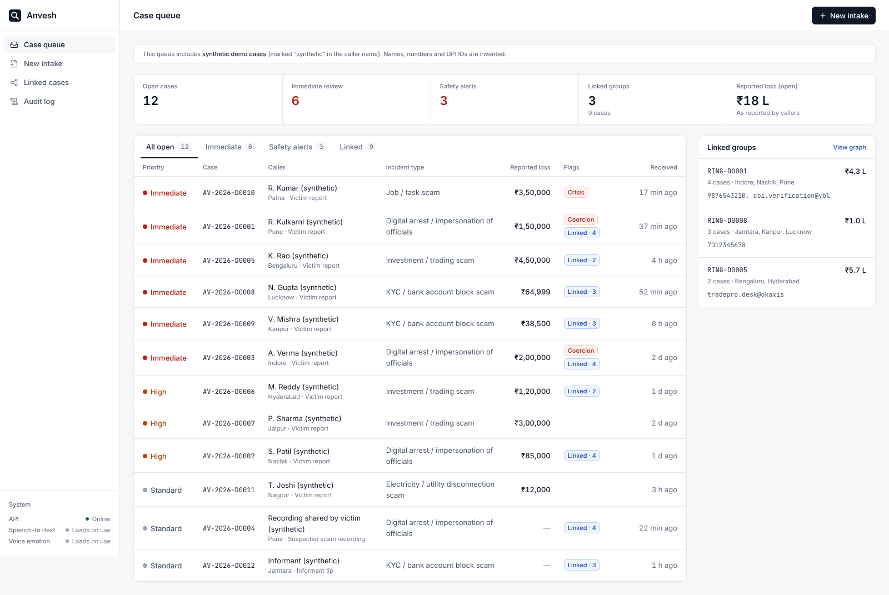
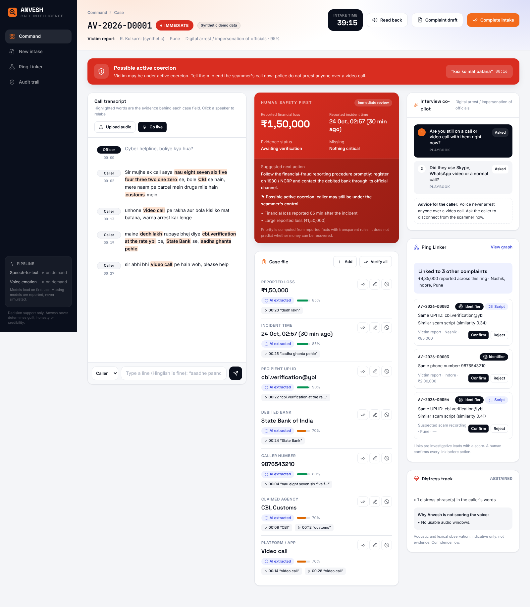
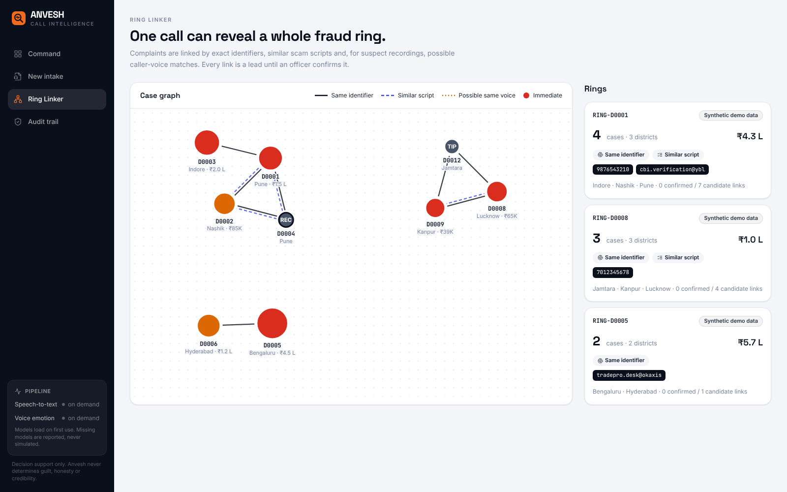

# Anvesh — every call solves more than one case

**Anvesh** (Sanskrit/Hindi: *search, investigation*) turns a cybercrime victim's phone call into an
**evidence-linked case file in minutes**, then links it to earlier complaints so one call can
surface a whole **fraud ring**. It is built for Indian cyber cells and fraud teams: Hinglish speech,
UPI-era fraud, and the golden hour after money leaves an account.

> Built for the VecnaVerse National Level Hackathon · PS: *Real-Time Speech Emotion Analysis for
> Cybercrime Investigation* (Cybersecurity).
>
> **Designed and developed by [Yashvi Chotalia](https://github.com/YashviChotalia).**

**Landing page:** `/welcome` is a scroll-driven short film that shows the problem: a "digital arrest" call, a
voice-changed caller, the account emptied in 47 seconds, then *Introducing Anvesh*. It has graded footage, Hinglish
subtitles and a soundtrack, and the visuals pulse on the music's beat.



| Case workspace | Ring Linker |
|---|---|
|  |  |

*Screens show official NCRB / I4C / DoT statistics (National data, Official context) and the labelled training scenarios from `python -m anvesh.seed`.*

---

## What makes it different

| | Typical SER demo | Anvesh |
|---|---|---|
| Output | An emotion label | A case file: amount, time, UPI ID, bank, phone, UTR, scam type, each linked to the exact second of audio |
| Scope | One call | **Ring Linker** connects cases by identifier, scam script and (for suspect recordings) caller voice |
| Roles | Everyone treated the same | Operator-confirmed **victim / suspect-recording / informant** modes; emotion scoring is **off for suspects** |
| Urgency | "Fear 0.81" | Golden-hour triage from **reported facts**; distress is a separate human-safety track |
| Trust | Black box | Abstains when unsure, shows evidence, hash-chained audit log, officer verify/correct on every field |

### Signature features

1. **Call → case file.** Hinglish normaliser ("saadhe paanch hazaar" → ₹5,500, "ramesh at the rate okaxis" →
   `ramesh@okaxis`, "nau aath saat…" → `987…`, "aadha ghanta pehle" → a clock time) feeds an extractor that keeps a
   character-and-time pointer back to the words it came from.
2. **Ring Linker.** Exact identifier matches, multilingual script similarity, and speaker-embedding voice leads on
   suspect recordings. Every link is a scored lead that an officer confirms or rejects.
3. **Interview co-pilot.** Next questions from missing fields plus a scam-type playbook (digital arrest, investment,
   KYC, courier, sextortion, job, utility).
4. **Read-back confirmation.** Reads the captured facts back to the caller in Hindi for a yes or a correction.
5. **Coercion and crisis alerts.** Phrases like "kisi ko mat batana" / "abhi bhi video call pe hain" raise a
   possible-active-coercion alert; crisis language triggers a hand-over prompt (Tele-MANAS 14416).
6. **Distress track.** emotion2vec voice emotion + pitch/energy/pace change against the caller's own baseline,
   sustained (not single-spike), role-gated, and **abstains** on poor audio or unvalidated languages.
7. **Synthetic-voice check.** A deepfake-audio classifier plus acoustic cues (jitter, shimmer, noise floor, rhythm)
   separate a live human voice from a cloned or replayed one, so a real victim, a real informant and a staged
   "victim" can be told apart. Shown as *likely real / needs verification / likely synthetic*, never as proof.
8. **Live call mode.** Microphone audio streams over a WebSocket; transcript, emotion and distress update every few
   seconds, and a complainant is never shown as "happy".
9. **Tamper-evident audit.** SHA-256 of every recording, encrypted evidence at rest, hash-chained events for every
   view, AI output and human correction, and a one-click chain verification.

---

## Architecture

```
Next.js workspace ──► FastAPI (REST + WebSocket live audio)
                        ├─ speech: faster-whisper ASR · emotion2vec · ECAPA speaker embeddings · deepfake-audio check
                        ├─ nlp: Hinglish normaliser → extractor (+evidence) → playbooks/co-pilot → safety signals
                        ├─ triage: transparent rules on reported facts      ├─ distress: role-gated, abstaining
                        ├─ linker: identifiers · script similarity · voice leads → rings
                        └─ audit + storage: HMAC hash chain · AES-256-GCM encrypted fields and evidence
                     SQLite (dev) / PostgreSQL (compose)
```

Modular monolith with clear module boundaries; models load lazily and `/api/health` reports exactly what is loaded.
A missing model is reported, never simulated.

---

## Quick start (laptop)

**Windows, one click:** double-click `setup.bat` once (installs everything, runs the tests, loads demo data),
then `start.bat` to launch. Logs go to `logs\` (`setup.log`, `backend.log`, `frontend.log`).

**Manual setup**

**Backend** (Python 3.10–3.12)

```bash
cd backend
python -m venv .venv && source .venv/bin/activate        # Windows: .venv\Scripts\activate
pip install -r requirements-dev.txt
pip install -r requirements-ml.txt                         # speech models, installed separately (CPU is fine)
python -m anvesh.seed --reset                              # training scenarios for the Ring Linker (--none for an empty DB)
uvicorn anvesh.api:app --port 8000
```

**Frontend** (Node 18+)

```bash
cd frontend
cp .env.example .env.local
npm install
npm run dev                                                # http://localhost:3000
```

**Deploy the web app on Vercel:** import the repository, set **Root Directory** to `frontend` (framework: Next.js),
and set `NEXT_PUBLIC_API_URL` to wherever the FastAPI backend runs. The landing page at `/welcome` needs no backend.

**Everything in containers:** `ANVESH_DATA_KEY=$(python -c "from cryptography.fernet import Fernet;print(Fernet.generate_key().decode())") docker compose up --build`

### Configuration

| Variable | Default | Meaning |
|---|---|---|
| `ANVESH_ASR_MODEL` | `small` | faster-whisper size (`base` for low-RAM laptops, `medium` for accuracy) |
| `ANVESH_EMOTION_MODEL` | `iic/emotion2vec_plus_base` | voice-emotion checkpoint |
| `ANVESH_ENABLE_SPEAKER` | `1` | ECAPA speaker embeddings for suspect recordings |
| `ANVESH_TEXT_EMBEDDER` | *(empty)* | e.g. `paraphrase-multilingual-MiniLM-L12-v2` for cross-language script links |
| `ANVESH_DATA_KEY` | dev key file | Fernet key for evidence encryption (**set this in any real deployment**) |
| `ANVESH_MASTER_KEY` | *(generated in ~/.anvesh/keys)* | 32-byte base64 master key for field and evidence encryption (use a secret manager in production) |
| `ANVESH_KEY_DIR` | `~/.anvesh/keys` | where the generated master key is kept (outside the data folder) |
| `ANVESH_SESSION_IDLE_MIN` / `ANVESH_SESSION_MAX_HOURS` | `30` / `12` | session idle timeout and maximum lifetime |
| `ANVESH_RETENTION_DAYS` | `0` (keep) | erase closed cases older than this on start-up |
| `ANVESH_MAX_UPLOAD_MB` | `100` | largest audio upload accepted |
| `ANVESH_VALIDATED_LANGS` | `en,hi` | languages where the voice distress track is allowed to score |

---

## Quality

```bash
cd backend && pytest -q            # unit + API tests (no models needed)
python eval/run_eval.py            # field-extraction evaluation, see EVALUATION.md
cd ../frontend && npm run typecheck && npm run build
```

CI runs all of the above on every push.

---

## Responsible use

- Outputs are **indicative signals for human review**, never evidence of honesty, intent or guilt.
- Emotion and voice-stress scoring are **disabled for suspects** by design; voice-similarity links are leads only.
- Financial priority comes from reported facts with transparent rules; it does **not** predict recoverability.
- Hashing shows files and logs were not altered after capture; it does not prove a recording is authentic,
  complete or lawfully obtained.
- **Official data, not invented numbers.** `backend/anvesh/data/official/` holds byte-identical copies of six files published on
  data.gov.in (NCRB *Crime in India 2023* tables 9A.1, 9A.3, 9B.3; Rajya Sabha answers with I4C NCRP complaint data and DoT
  Chakshu scam categories). `sources.json` records each file's page, report and SHA-256; Anvesh refuses to start the data
  view if a hash or a published total does not match. Shown on **National data** and in each case's **Official context**.
- **Calls are training scenarios.** No government body publishes victim calls (personal data and evidence), so the call
  transcripts are scripted. Each one reproduces a scam category from the Chakshu data, in a district covered by NCRB data,
  and is labelled *Training scenario* in the UI. Phone numbers and UPI handles are placeholders.
- See [`LICENSES.md`](LICENSES.md) before any commercial use of models or datasets.

## Roadmap

Telephony integration for live 1930 calls · NCRP-format export · diarization fallback · fine-tuned
classifier on commercially licensed data · per-language validation · campaign radar for emerging scam scripts ·
multi-tenant deployment and DPDP compliance mapping.

## Security

Anvesh requires named accounts with roles (operator, supervisor, administrator). On first start, open the app on the
server computer and create the administrator; add officers under **Users**. Personal data is encrypted field by field
(AES-256-GCM) with a master key kept outside the data folder, identifiers are linked through keyed blind indexes, the
audit log is an HMAC-signed chain with no personal data in it, and every route, role and protection is covered by
`backend/tests/test_security.py`. See [SECURITY.md](SECURITY.md) for the threat model, controls and known limits.
**Back up `~/.anvesh/keys/master.key` separately from the data: without it the encrypted cases cannot be read.**

---

## Author

**Yashvi Chotalia** — design, development and research. Footage on the landing page is from Pexels (free licence);
the people shown are actors. Official statistics are credited in `backend/anvesh/data/official/sources.json`.
